

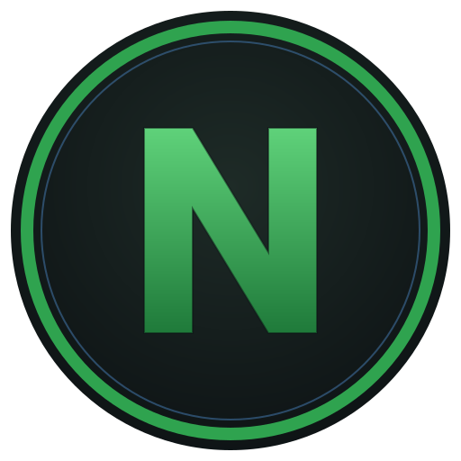

# NazoOS

**A gaming desktop built on openSUSE Tumbleweed. You never need a terminal.**

KDE Plasma on Wayland · Steam gaming mode · optional gaming kernel · one-click drivers and codecs · a snapshot before every update

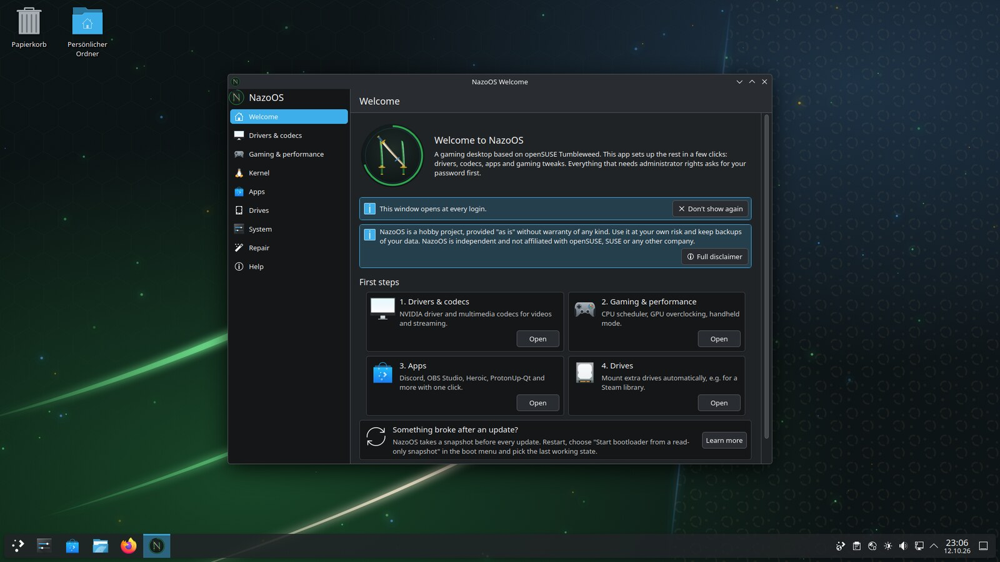

> [!WARNING]
> NazoOS is a hobby vibecoding project in **early development**. Expect bugs and keep backups. It is independent of openSUSE and SUSE, see [`DISCLAIMER.md`](DISCLAIMER.md).

## Why NazoOS?

Tumbleweed is a fast, well-tested rolling release with Btrfs snapshots built in. NazoOS keeps that base and adds what a gamer would otherwise set up by hand: Steam, Proton tools, controller drivers, codecs, performance tweaks, and graphical tools for anything that needs root.

- **No terminal needed.** Drivers, codecs, kernel, updates, repairs and rollbacks all have a button. Admin actions ask for your password in a normal dialog.
- **You can always go back.** A Btrfs snapshot is taken before every update and software change. Older states can be picked from the boot menu.
- **Close to upstream.** It uses the standard Tumbleweed repositories plus one NazoOS repository. Packman (codecs) and NVIDIA are opt-in.

## Features

### 🎮 Gaming out of the box
- **Steam, Lutris, Gamescope, GameMode, MangoHud, Wine, Protontricks, Winetricks** already installed, including 32-bit Mesa and Vulkan drivers for AMD, Intel and Nouveau
- **Steam gaming mode** (the Steam Deck interface) as a session on the login screen, or one click from the desktop. It can also start like a console when the computer boots. Back to the desktop through Steam → Power → *Switch to Desktop*
- **Controllers:** Xbox wireless (xone, xpadneo), PlayStation, wheels and flight sticks (game-devices-udev), adjustable USB poll rate up to 1000 Hz
- **One image for desktops and handhelds.** On a Steam Deck, ROG Ally, Legion Go, MSI Claw and similar devices the installer picks *Handheld* by itself and installs InputPlumber, Deck fan control and audio DSP
- **One-click apps:** ProtonUp-Qt, ProtonPlus, Heroic, Bottles, Prism Launcher, RetroArch, Moonlight, Discord, OBS Studio, Waydroid and more
- **Hardware tools:** LACT (GPU clocks and fans), CoolerControl, OpenRGB

### ⚡ Performance tweaks
- `vm.max_map_count` raised for games that need it, split-lock mitigation off, zram swap, tuned I/O schedulers, `ntsync` for Wine/Proton
- **sched_ext** CPU scheduler (`scx_lavd` by default), switchable in the Welcome app
- **PipeWire** set up for low latency, with upmixing to 5.1
- **Shader cache** and journald limits tuned for large game libraries
- **VRAM for the game in front:** `dmemcg-booster` and `plasma-foreground-booster` keep the focused game's data in VRAM when memory runs short

### 🐧 Optional NazoOS kernel
Installed with one click next to the openSUSE kernel, which stays in the boot menu as a fallback:
- BORE scheduler, BBRv3, 1000 Hz, full preemption
- Handheld patches (Steam Deck, ROG Ally, MSI Claw, Zotac Zone, AYANEO, GPD, OneXPlayer)
- HDMI 2.1 VRR for AMD, ACS override, v4l2loopback, Binder for Waydroid
- Signed modules for the NVIDIA open driver (G07) and Xbox controllers
- Works with Secure Boot: the key is enrolled through a password dialog

More in [docs/kernel.md](docs/kernel.md).

### 🛟 Safe updates and rollback
- **NazoOS Update** runs `zypper dup` and Flatpak updates in one click. It tells you when updates are waiting and takes a snapshot first
- **Snapshots in the boot menu:** pick *Start bootloader from a read-only snapshot*, and NazoOS offers to make that state permanent
- **Btrfs Assistant** for snapshots and subvolumes
- **Repair page:** checks for broken repositories, a missing NVIDIA module, failed services, a mixed Packman install and low disk space, then fixes them with a button

### 🎨 Look and feel
- KDE Plasma 6 with **Breeze Dark**, **Wayland only** (Xwayland stays for Steam and older games)
- Matching NazoOS theme for GRUB, the Plymouth boot splash, the login screen and the wallpaper
- **Discover** (Flatpak, Flathub) and **Myrlyn** (RPM packages) for software
- Calamares installer with a disclaimer page and the desktop/handheld choice

## Screenshots

<table>
  <tr>
    <td width="50%">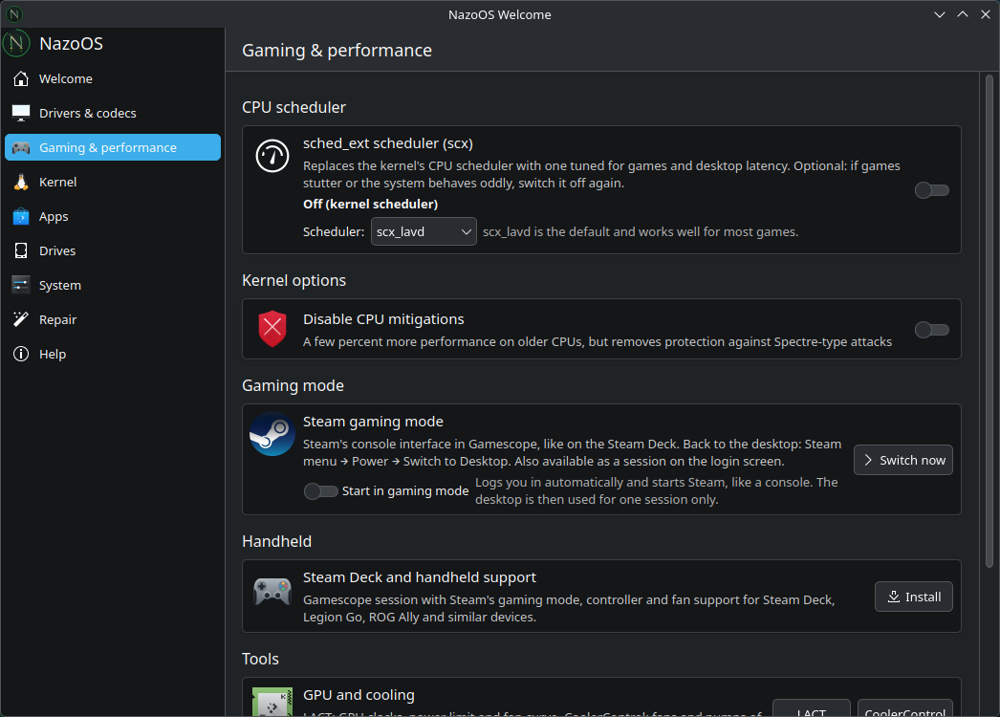 <b>Gaming & performance</b>: CPU scheduler, gaming mode, handheld support</td>
    <td width="50%">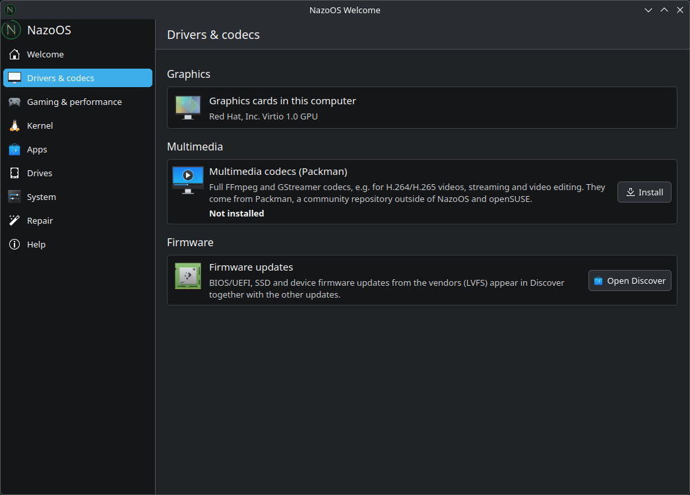 <b>Drivers & codecs</b>: NVIDIA, Packman codecs, firmware updates</td>
  </tr>
  <tr>
    <td>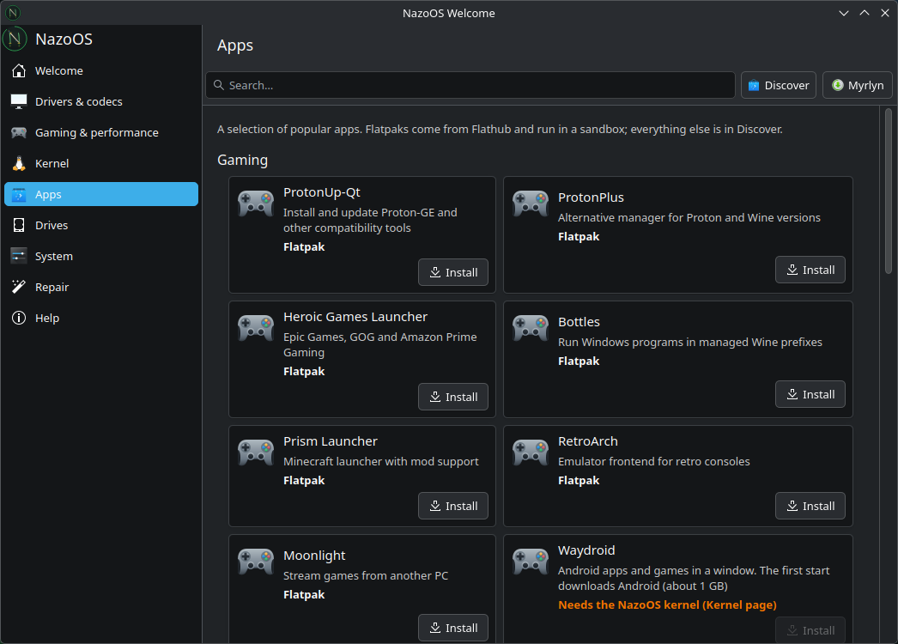 <b>Apps</b>: popular launchers and tools with one click</td>
    <td>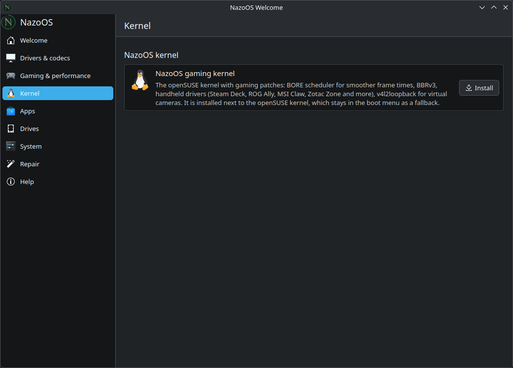 <b>Kernel</b>: the optional NazoOS gaming kernel</td>
  </tr>
  <tr>
    <td>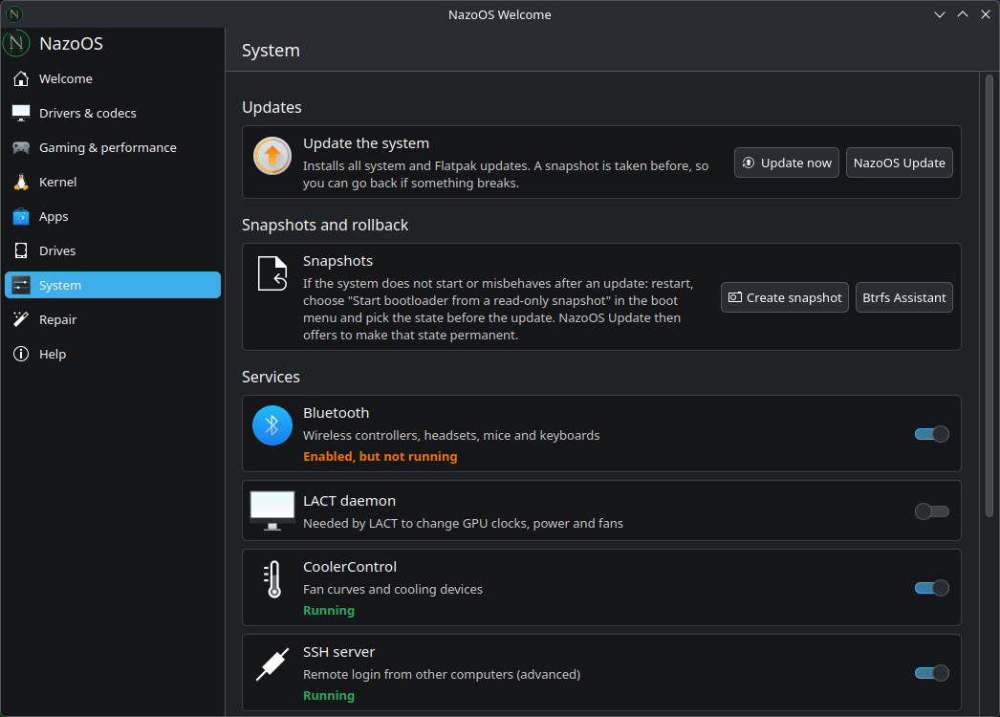 <b>System</b>: updates, snapshots, services</td>
    <td>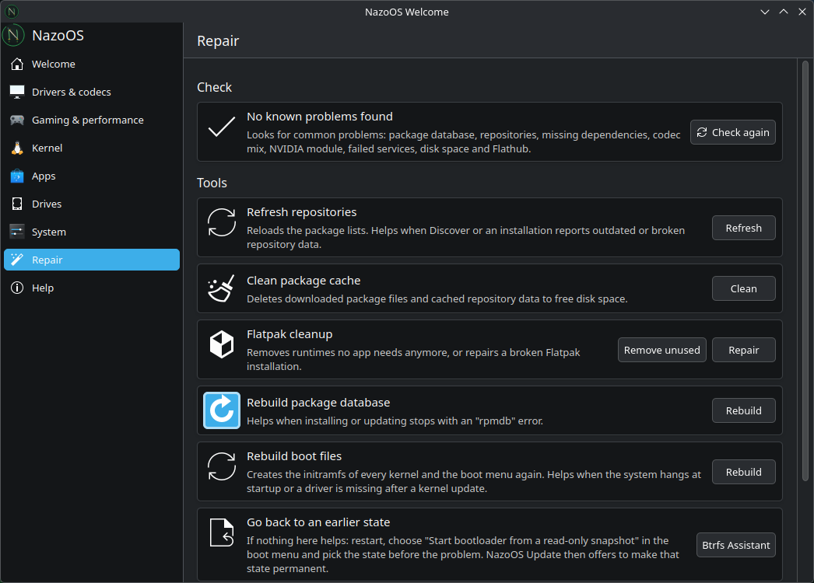 <b>Repair</b>: finds common problems and fixes them</td>
  </tr>
  <tr>
    <td>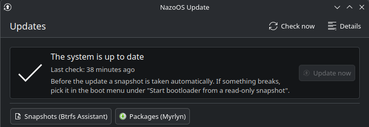 <b>NazoOS Update</b>: updates with a snapshot first</td>
    <td>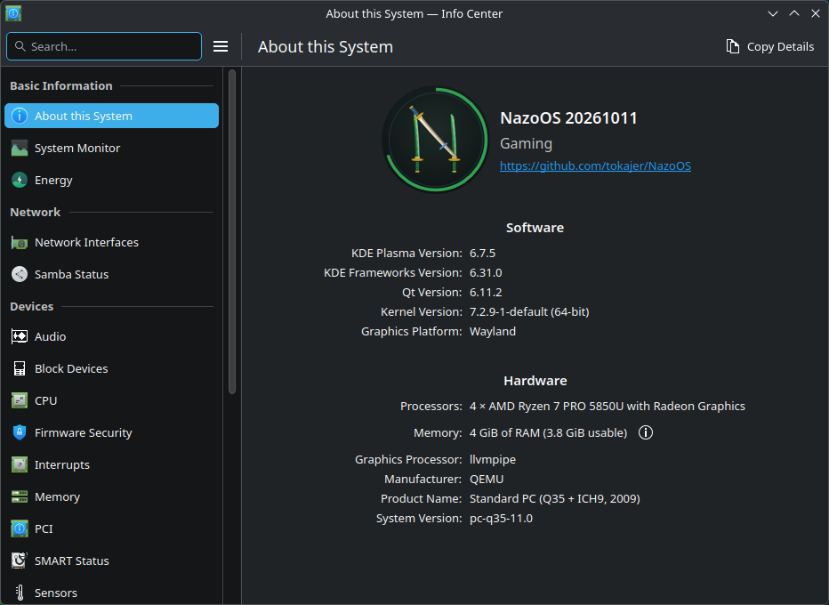 <b>About this System</b></td>
  </tr>
  <tr>
    <td>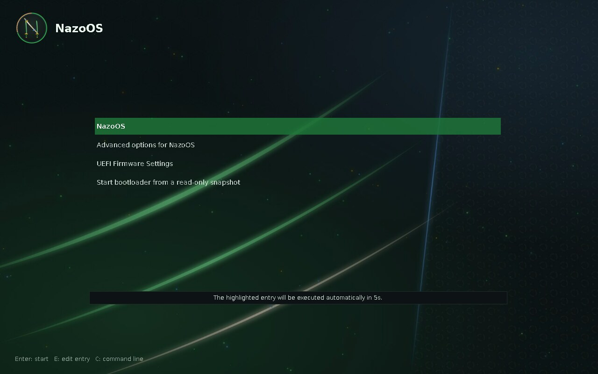 <b>Boot menu</b> with snapshot entry</td>
    <td>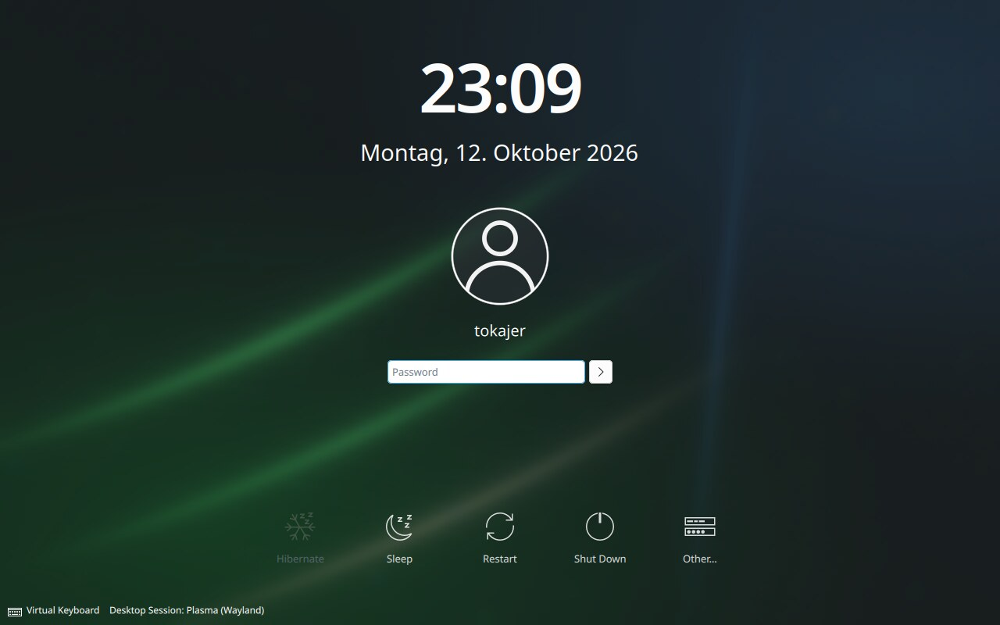 <b>Login screen</b> (SDDM on Wayland)</td>
  </tr>
</table>

Screenshots taken in a virtual machine.

## Download

There is no stable release yet. Development builds come from the [Open Build Service](https://build.opensuse.org/project/show/home:Tokajer:nazoos:devel). Get **`NazoOS.x86_64-live.iso`** (live system with the installer) from the [image folder](https://download.opensuse.org/repositories/home:/Tokajer:/nazoos:/devel/images/). While a new image is building, the folder can be empty for a while.

**Requirements:** x86-64 PC with UEFI, 4 GB RAM, 30 GB disk. Write the ISO to a USB stick with [Fedora Media Writer](https://flathub.org/apps/org.fedoraproject.MediaWriter), [Impression](https://flathub.org/apps/io.gitlab.adhami3310.Impression) or `dd`.

## Documentation

- [NazoOS Welcome](docs/welcome.md): first steps after the installation
- [NazoOS Update](docs/update.md): updates, notifications, going back to a snapshot
- [NazoOS kernel](docs/kernel.md): the optional gaming kernel and Secure Boot
- [Gaming mode and handhelds](docs/gaming-mode.md)
- [System settings](docs/system-settings.md): where to find what YaST does on openSUSE

## Repository layout

| Path | Contents |
|---|---|
| [`packages/`](packages) | RPM packages: pattern, tweaks, branding, Welcome, Update, session, deck support, … |
| [`kernel/`](kernel) | Patches and config for `kernel-nazoos` (on top of openSUSE's Kernel:stable) |
| [`kiwi/`](kiwi) | KIWI image description for the live/installer ISO |
| [`docs/`](docs) | User documentation |

Every push to this repository builds the packages and images in OBS (`home:Tokajer:nazoos:devel`).

## Licensing

This repository is [REUSE](https://reuse.software) compliant; the mapping lives in `REUSE.toml`, the license texts in `LICENSES/`.

- Code, packages, configuration: GPL-3.0-or-later
- Kernel patches (`kernel/patches/`): GPL-2.0-only
- Documentation and artwork (`docs/`, wallpaper, boot theme): CC-BY-SA-4.0

The name and logo "NazoOS" are not covered by these licenses, see [`TRADEMARK.md`](TRADEMARK.md). Warranty and independence notice: [`DISCLAIMER.md`](DISCLAIMER.md).

Not affiliated with openSUSE, SUSE, Valve or any other company.

